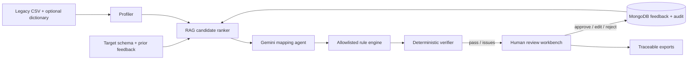

# InsureMap AI

**Evidence-backed legacy insurance data mapping with an AI verifier and human approval.**

InsureMap AI is a synthetic-data prototype for the Flarre AI Innovation Challenge 2026. It profiles legacy CSVs, retrieves relevant target definitions and dictionary notes (RAG), ranks candidate target fields, asks Gemini to select a mapping and a rule from a fixed vocabulary, executes the rule in a safe deterministic engine, validates the output, and places uncertain mappings in a review queue. It never executes model-written code. Retrieval is local lexical matching with insurance-specific term expansion and reviewer examples; the MVP does not require embeddings or a hosted vector database.

## What makes the demo distinct

- **Content-addressed evidence passport:** each trace export carries source, target-schema and dictionary SHA-256 fingerprints alongside the profile, retrieved candidates, rule and verifier findings. Changing any input makes the passport stale, so an approval can be checked against the exact inputs it reviewed.
- **Evidence before confidence:** column patterns, dictionary excerpts and ranked target candidates travel with each proposal.
- **Executable checks:** proposed rules run on sample rows; code coverage, type, dates, required values and row counts are checked.
- **Cross-schema reviewer memory:** edits are retained locally and retrieved on later runs. The evaluation compares this feedback path on a renamed policy variant against feedback disabled and reports improvements and regressions.
- **Bounded repair with a human stop:** Gemini can revise a failing rule at most twice; an unresolved rule stays in the review queue. A regression test enforces this ceiling.
- **Safe-by-design:** the model can choose only typed rules from an allowlist. `CUSTOM` is flagged for a person and is never executed.
- **Privacy-conscious demo:** only synthetic data ships in the repository. Do not upload real policyholder data to a consumer model.

## Run locally (free)

1. Install Python 3.11 or newer.
2. `python -m venv .venv`
3. Activate it, then `python -m pip install -r requirements.txt`
4. Copy `.env.example` to `.env` and add your Gemini API key (`GEMINI_API_KEY`). API key creation and model quotas are managed by Google AI Studio; free-tier access and quotas can change. The current default model is `gemini-2.5-flash`.
5. Create a MongoDB Atlas Free cluster, create a database user, allow your current IP in Network Access, and paste the Atlas connection URI into `MONGODB_URI` in `.env`. Keep credentials private. Atlas Free clusters have limits and require network access to Atlas.
6. `python data/generate_data.py`
7. `streamlit run app.py`

To measure the local retrieval/rule baseline, run `python eval/run_eval.py`. To run the complete Gemini-backed evaluation after adding a key, use `python eval/run_gemini_eval.py`. The latter sends synthetic columns to Gemini and consumes the API quota shown in your account.

The Streamlit workbench always uses **Gemini** for mapping proposals and verifier-guided repair; the UI has no Preview mode. A Gemini key and MongoDB Atlas URI are required to run mappings. Profiling, retrieval, deterministic transformations and verification remain local so outputs can be checked. MongoDB stores reviewer decisions, feedback, audit history and mapping cache. The separate local baseline evaluator remains available for offline benchmarking.

## Demo flow

1. Open the included synthetic policy CSV and target schema.
2. Run Gemini mapping; the workbench requires a configured API key.
3. Inspect a code/date/currency rule and its evidence, validation findings, and sample output.
4. Approve or correct an item; run `LEGACY_POLICY_V2.csv` and show feedback memory.
5. Export the traceability matrix, mapping specification, SQL and validation report.

## Architecture

## Evaluation

`python eval/run_eval.py` measures top-1 accuracy, top-3 candidate recall, rule/verifier pass rate, auto-accept precision, human-review share, runtime and a feedback-on/off ablation against the synthetic gold file. The V2 variant shares the synthetic generator and semantics, so this is an oracle-style diagnostic, not an independent generalization study. Gold is hand-authored; results are not evidence of carrier performance. Run `python -m unittest discover -s tests -v` to check transformations, verifier edge cases, passport invalidation, and the repair bound.

## Limitations

Target entities are simplified and synthetic, not Guidewire or Duck Creek schemas. No carrier data, production database connection, authentication, multi-user access, or real deployment is included. Gemini quota availability may vary. Approvals are a prototype aid and do not certify a migration.

## Project layout

- `app.py` Streamlit workbench
- `schema_bridge/` profiler, retrieval, Gemini adapter, rule engine, verifier, storage, orchestration and exports
- `data/` generator, target schema, data dictionary, gold mapping and synthetic CSVs
- `eval/run_eval.py` reproducible toy evaluation
- `proposal/` submission-ready proposal draft and demo pitch notes
